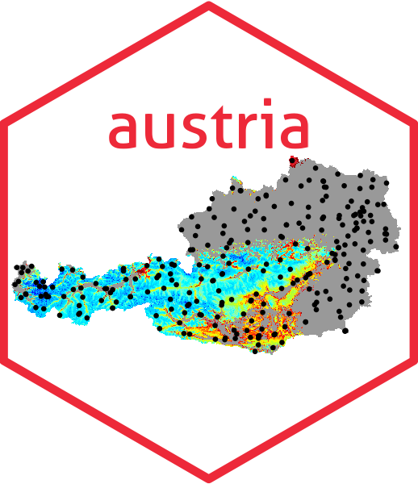

# austria

*austria* is an R package that gives access to Austrian historical weather and
snow data published by [GeoSphere Austria](https://www.geosphere.at/) through
its [Dataset API](https://dataset.api.hub.geosphere.at/v1/docs/).



The package wraps the GeoSphere REST endpoints in a few R functions that return
ready-to-use `data.table`, `sf` or `terra::SpatRaster` objects, and it can write
the downloaded series directly as meteorological input files for the
[GEOtop](https://github.com/geotopmodel/geotop) hydrological model (via
[geotopbricks](https://CRAN.R-project.org/package=geotopbricks)).

## Main features

- **Catalogue discovery**: list all datasets available on the GeoSphere Data
  Hub (`get_datasets()`) and the variables/parameters of each dataset
  (`get_variables()`).
- **Station metadata**: get the historical weather stations network as an `sf`
  point layer (`get_stations()`).
- **Point time series**: download hourly time series from the INCA 1 km
  analysis (or other gridded datasets such as SNOWGRID) for a location or a
  bounding box (`get_ts()`).
- **Spatio-temporal grids**: download gridded data as netCDF and open it as a
  time-aware `SpatRaster` (`get_inca_ts()`).
- **GEOtop integration**: read station coordinates from a GEOtop simulation
  (`geotop.inpts`), convert variable names and units, and write GEOtop meteo
  files.
- **Time helpers**: convert between `POSIXct` and ISO 8601 strings
  (`to_iso8601()`, `from_iso8601()`).

## Installation

The package is not on CRAN. Install the development version from GitHub:

```r
# install.packages("remotes")
remotes::install_github("ecor/austria")
```

Dependencies: `sf`, `data.table`, `lubridate`, `terra`, `zoo`, `jsonlite`,
`httr`, `stringr`, `dplyr`, `rlang`, `geotopbricks`.

An internet connection is needed: all data are fetched on the fly from
`https://dataset.api.hub.geosphere.at/v1/`.

## Function overview

| Function | Purpose | Returns |
|---|---|---|
| `get_datasets()` | List all GeoSphere datasets | named list (parsed JSON) |
| `get_variables(url)` | Parameters available in a dataset (default: INCA hourly 1 km) | `data.table` |
| `get_stations(url)` | Historical climate stations (default: `klima-v1-10min`) | `sf` or `data.table` |
| `get_ts(...)` | Time series for a point / bounding box | `data.table`, `zoo` (GEOtop) or raw response |
| `get_inca_ts(...)` | Gridded data downloaded as netCDF | `SpatRaster` or `data.table` |
| `geotop_var_names_and_unit_conversion()` | Mapping INCA → GEOtop variable names, units and offsets | list |
| `to_iso8601()` / `from_iso8601()` | `POSIXct` ↔ ISO 8601 conversion | character / `POSIXct` |
| `csv_to_dt()` | Parse a CSV API response into a `data.table` | `data.table` |

## Usage

```r
library(austria)
library(terra)
library(sf)
```

### 1. Explore datasets and variables

```r
# All datasets on the GeoSphere Data Hub
datasets <- get_datasets()
names(datasets)[grepl("snowgrid", names(datasets))]

# Variables of the INCA hourly 1 km analysis (default)
inca_vars <- get_variables()
inca_vars

# Variables of the SNOWGRID daily 1 km dataset
snow_vars <- get_variables(
  "https://dataset.api.hub.geosphere.at/v1/grid/historical/snowgrid_cl-v2-1d-1km/metadata/parameters"
)
```

### 2. Weather stations

```r
stations <- get_stations()          # sf object, EPSG:4326, English column names
plet(vect(stations), col = "green") # interactive map
```

### 3. Time series at a location (INCA, hourly)

`get_ts()` builds the API request from a URL template, replacing the
placeholders `VARIABLES`, `START_TIMESTAMP`, `END_TIMESTAMP`, `LAT1S`, `LAT2N`,
`LON1W`, `LON2E`. The spatial window can be given as:

- a point (`lat`, `lon`) plus a window `size` (degrees, default `0.1`), or
  `latsize` / `lonsize`;
- explicit bounds (`lat1s`, `lat2n`, `lon1w`, `lon2e`);
- any spatial object accepted by `sf::st_bbox()` through `ext`.

Timestamps can be strings in the form `"YYYY-MM-DDTHH"` (UTC) or `POSIXct`
objects (converted to UTC internally).

```r
# Seefeld in Tirol
lat <- 47.329444
lon <- 11.189167

ts <- get_ts(lat = lat, lon = lon,
             start_timestamp = "2021-01-01T00",
             end_timestamp   = "2022-01-01T00")

# Same request with POSIXct timestamps and a subset of variables
start <- as.POSIXct("2022-01-01", tz = "Etc/GMT-1")
end   <- start + lubridate::years(1)
ts2 <- get_ts(lat = lat, lon = lon, variable = c("T2M", "RR"),
              start_timestamp = start, end_timestamp = end)

attr(ts2, "url")  # the API request actually sent
```

By default the result is a `data.table` with a `POSIXct` `time` column (time
zone `Etc/GMT-1`), coordinates and one column per variable; duplicated
time/location records are removed.

### 4. Other datasets: SNOWGRID

Any GeoSphere dataset with the same request structure can be queried by
changing the URL template:

```r
url_snowgrid <- paste0(
  "https://dataset.api.hub.geosphere.at/v1/timeseries/historical/snowgrid_cl-v2-1d-1km",
  "?parameters=VARIABLES&start=START_TIMESTAMP%3A00&end=END_TIMESTAMP%3A00",
  "&lat_lon=LAT2N%2CLON2E&lat_lon=LAT1S%2CLON1W&output_format=csv"
)

snow_ts <- get_ts(url_template = url_snowgrid, variable = snow_vars$name,
                  lat = lat, lon = lon,
                  start_timestamp = "2021-01-01T00",
                  end_timestamp   = "2022-01-01T00")
```

### 5. Gridded data as a `SpatRaster`

`get_inca_ts()` requests netCDF output, saves it (by default to a temporary
`.nc` file, or to `ncfilename`) and returns a time-aware `SpatRaster`:

```r
# Bounding box of the Karwendel area shipped with the package
v <- st_read(system.file("ext_data/bbox_kw_area.shp", package = "austria"))

start <- as.POSIXct("2023-01-01", tz = "Etc/GMT-1")
end   <- start + lubridate::days(2)

inca <- get_inca_ts(ext = v, start_timestamp = start, end_timestamp = end)
rr   <- get_inca_ts(ext = v, start_timestamp = start, end_timestamp = end,
                    variable = "RR", ncfilename = "rr.nc")
terra::time(rr)
plot(rr[[1:4]])
```

With `return_data_table = TRUE` the raster is converted to a long `data.table`
(`cell`, `x`, `y`, `time`, `variable`, `values`). For a single pixel,
`wide_table = TRUE` returns one column per variable — handy for using a grid
cell as a "virtual station":

```r
pts <- st_read(system.file("ext_data/karwendel_inca_1km_points.shp", package = "austria"))
xy  <- st_coordinates(pts)

cell_ts <- get_inca_ts(lon = xy[1, 1], lat = xy[1, 2], size = 0.005,
                       start_timestamp = start, end_timestamp = end,
                       return_data_table = TRUE, wide_table = TRUE)
```

SNOWGRID grids work in the same way with a `grid/historical/...` URL template
and `output_format=netcdf`.

### 6. GEOtop integration

When `use_geotop = TRUE`, station coordinates are read from the
`MeteoStationLatitude` / `MeteoStationLongitude` keywords of the `geotop.inpts`
file in `wpath`, and `level` selects the station. With `as_geotop = TRUE`, INCA
variables are renamed after the GEOtop header keywords and converted to GEOtop
units (e.g. air pressure from Pa to hPa) and a `zoo` object is returned. With
`write_geotop_meteo_file = TRUE` the series is also written to the file
prefix given by the `MeteoFile` keyword.

```r
wpath <- system.file("kw_meteo_template", package = "austria")
# (copy it to a writable folder before writing files)

start <- as.POSIXct("2023-01-01", tz = "Etc/GMT-1")
end   <- start + lubridate::years(1)

# Time series for station 8 of the GEOtop set-up
ts_st8 <- get_ts(wpath = wpath, level = 8, use_geotop = TRUE,
                 start_timestamp = start, end_timestamp = end)

# Write GEOtop meteo files for stations 10 to 20
for (level in 10:20) {
  get_ts(wpath = wpath, level = level, use_geotop = TRUE,
         start_timestamp = start, end_timestamp = end,
         as_geotop = TRUE, write_geotop_meteo_file = TRUE)
}
```

The default INCA → GEOtop mapping is:

| GEOtop header | INCA variable | Conversion |
|---|---|---|
| `HeaderIPrec` | `RR` (precipitation, hourly) | × 1 |
| `HeaderWindVelocity` | `F` (wind speed) | × 1 |
| `HeaderWindDirection` | `D` (wind direction) | × 1 |
| `HeaderWindX` / `HeaderWindY` | `UU` / `VV` (wind components) | × 1 |
| `HeaderRH` | `RH2M` (relative humidity) | × 1 |
| `HeaderAirTemp` | `T2M` (air temperature) | × 1 |
| `HeaderAirPress` | `P` (air pressure) | × 1/100 (Pa → hPa) |
| `HeaderSWglobal` | `GL` (global radiation) | × 1 |

It can be customised by passing a modified list from
`geotop_var_names_and_unit_conversion()` to the `vars_headers` argument of
`get_ts()`.

### 7. Time conversion helpers

```r
x <- as.POSIXct(c("2021-01-01 00:00:00", "2021-01-01 01:00:00"), tz = "Etc/GMT-1")
to_iso8601(x)                 # with UTC offset
to_iso8601(x, tz = "toUTC")   # converted to UTC, no offset

from_iso8601(c("2021-01-01T00:00+00:00", "2021-01-01T01:00+00:00"),
             tz = "Europe/Vienna")
```

## Example data

The package ships some data under `inst/` for the Karwendel area (Tyrol):

- `ext_data/bbox_kw_area.shp` – bounding box of the study area;
- `ext_data/karwendel_inca_1km_points.shp` – selected INCA 1 km cell centres
  used as virtual stations;
- `ext_data/elevation/` – a 25 m DEM of the area and the INCA DEM (netCDF);
- `kw_meteo_template/` – a minimal GEOtop set-up (`geotop.inpts` and
  `input-meteo/`) used in the GEOtop examples;
- `example_get_inca_ts_v3.R` – a worked script comparing INCA and local DEM
  elevations to select representative INCA cells.

## Data sources and terms of use

Data are provided by GeoSphere Austria via the
[GeoSphere Data Hub](https://data.hub.geosphere.at/). Please check the licence
and citation requirements of each dataset on the Data Hub before using or
redistributing the data. The API has request-size limits: for long periods or
large areas, split the request into shorter time windows.

Useful references:

- API documentation: <https://dataset.api.hub.geosphere.at/v1/docs/>
- OpenAPI specification: <https://dataset.api.hub.geosphere.at/v1/openapi-docs>
- INCA hourly 1 km: <https://data.hub.geosphere.at/dataset/inca-v1-1h-1km>
- SNOWGRID daily 1 km: <https://data.hub.geosphere.at/dataset/snowgrid_cl-v2-1d-1km>

## Licence

EUPL-1.2. See [LICENSE](LICENSE).

## Author

Emanuele Cordano ([ORCID 0000-0002-3508-5898](https://orcid.org/0000-0002-3508-5898)),
[Rendena100](https://www.rendena100.eu).
